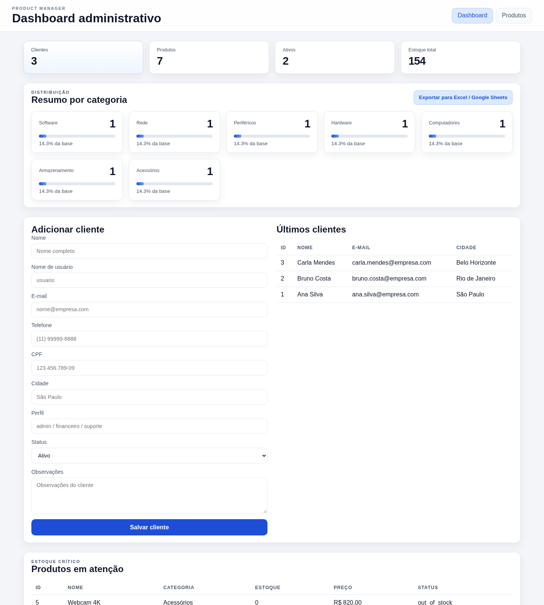
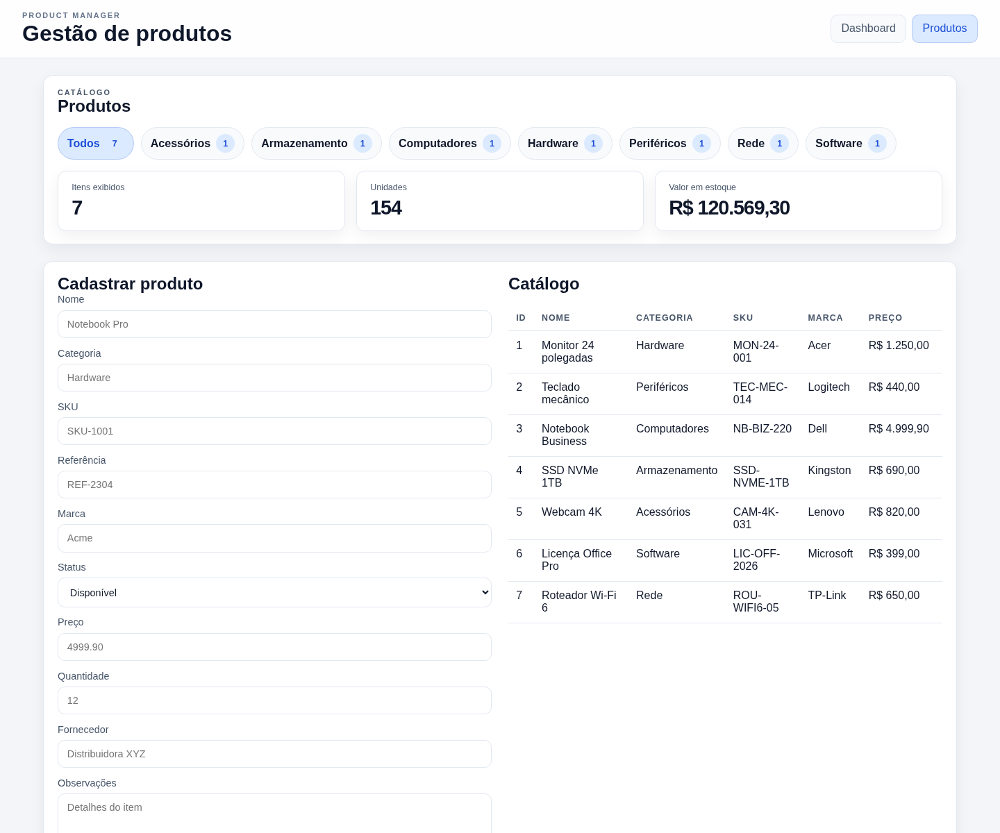

# Product Manager

<p align="center"></p>


Aplicativo de gestão de produtos para desktop Windows/Linux e PWA Android, com catálogo, estoque, usuários, financeiro operacional e exportação de dados.

**[Abrir aplicação Web](https://product-manager-14fq.onrender.com/login)** · [Site do projeto](https://mnl-nox.github.io/product_manager/) · [Documentação completa (Wiki)](https://github.com/mnl-nox/product_manager/wiki) · [Arquitetura](docs/architecture.md)

**Mantenedor:** [Manoel E. S. S. (`@mnl-nox`)](https://github.com/mnl-nox).

**Web e Android:** [Aplicação publicada](https://product-manager-14fq.onrender.com/login) · [Guia de implantação pública e APK](docs/deployment.md) · [Instalar como PWA](docs/platforms.md#android-pwa) · [Gerar APK Android](https://github.com/mnl-nox/product_manager/actions/workflows/android-apk.yml). A aplicação requer servidor HTTPS e armazenamento persistente.

## Objetivo do produto

O Product Manager foi criado para reunir cadastros de clientes e produtos que podem ficar espalhados em planilhas ou sistemas diferentes. Ele ajuda equipes pequenas a consultar o catálogo, acompanhar quantidades e identificar itens que precisam de atenção em um painel simples.

Hoje, o app oferece cadastro de clientes e produtos em um espaço de trabalho compartilhado por usuários autenticados, papéis de acesso, lançamentos financeiros operacionais, alertas de estoque configuráveis e exportação CSV/Excel/Google Sheets. A autenticação usa contas locais e o banco SQLite. Leia [o objetivo e os limites atuais](doc/objective.md), [o guia de instalação e uso](docs/installation-usage.md) e [a configuração técnica](docs/development.md).

## Funcionalidades

- Dashboard com totais, distribuição por categoria, clientes recentes e estoque crítico.
- Cadastro de clientes e produtos com validação de campos e unicidade.
- Edição, desativação, reativação e remoção administrativa de produtos.
- Busca por nome/SKU/marca/fornecedor, filtro por categoria e resumo de unidades e valor em estoque.
- Exportação do dashboard em CSV e Excel (`.xlsx`), além de integração opcional com Google Sheets.
- Contas com papéis de administrador, operação, financeiro e leitura; sessões seguras e proteção CSRF.
- Área financeira para registrar receitas/despesas realizadas ou previstas e consultar saldo operacional.
- Central de alertas de estoque com prioridade, limite padrão e limite mínimo por produto.
- Registro interno de bugs e riscos com prioridade e acompanhamento de estado.
- API JSON, banco SQLite e dados demonstrativos opcionais por configuração.

## Tela de exemplo

Captura do dashboard carregado com os dados de demonstração:



Catálogo de produtos:



## Pré-requisitos

- Python 3.10 ou superior (sem dependências externas para API e testes).
- GCC ou Clang com suporte a C23 e GNU Make, somente para o núcleo C legado.

## Executar a aplicação web

No aplicativo desktop, o primeiro acesso cria um token temporário local e abre o formulário seguro para provisionar o administrador, sem conta ou senha padrão. Para executar o servidor direto ou implantar o PWA, defina o token temporário de configuração. Siga [Instalação e primeiro acesso](docs/installation-usage.md#primeira-configuracao). Depois do bootstrap, toda a API de negócio exige sessão autenticada.

```bash
python3 api/app.py
```

Abra <http://127.0.0.1:8000>. O banco padrão é `db/product_manager.db`. Para usar outro caminho, defina `PRODUCT_MANAGER_DB` antes de iniciar o servidor:

```bash
PRODUCT_MANAGER_DB=/caminho/product_manager.db python3 api/app.py
```

### Executar com Docker

Para testar em um container local, gere um token temporário e suba o serviço com Docker Compose:

```bash
export PRODUCT_MANAGER_SETUP_TOKEN="$(python3 -c 'import secrets; print(secrets.token_urlsafe(32))')"
docker compose up --build -d
```

Abra `http://localhost:8000/login#setup_token=$PRODUCT_MANAGER_SETUP_TOKEN` para criar o primeiro administrador. O banco fica no volume `product-manager-data`. Para encerrar, execute `docker compose down`; os dados permanecem no volume. O Compose publica a porta somente no loopback e desativa cookies Secure para permitir o teste local por HTTP. Em uma implantação HTTPS, configure `PRODUCT_MANAGER_COOKIE_SECURE=1`.

No Podman rootless, o mesmo container pode ser construído e iniciado assim (gere o token como no exemplo acima):

```bash
podman build --network=none --format docker -t product-manager .
podman run -d --name product-manager --network=slirp4netns \
  -p 127.0.0.1:8000:8000 \
  -e PRODUCT_MANAGER_SETUP_TOKEN="$PRODUCT_MANAGER_SETUP_TOKEN" \
  -e PRODUCT_MANAGER_COOKIE_SECURE=0 \
  -v product-manager-data:/data:Z,U \
  product-manager
```

As rotas principais incluem `GET /api/health`, `GET /api/dashboard`, `GET /api/products`, `POST /api/products`, `POST /api/clients`, além das APIs financeira e de alertas. Veja [API e desenvolvimento](docs/development.md) para detalhes de sessão e permissões.

## Instalar por plataforma

- **Windows 10/11 x64:** o workflow de release gera um instalador `.exe` com Inno Setup.
- **Linux x64:** `make package-linux` gera `.deb` e também `.rpm` quando `rpmbuild` estiver instalado.
- **Android:** o frontend é um PWA instalável pelo Chrome. Hospede a aplicação atrás de HTTPS e escolha **Instalar app** ou **Adicionar à tela inicial**. O workflow publica um ZIP de implantação.

Para criar localmente o ZIP de implantação do PWA, use `make package-pwa`.

No Linux, os pacotes guardam o banco no diretório de dados do usuário. Para obter o instalador Windows e pacotes Linux construídos em seus ambientes nativos, execute o workflow **Cross-platform packages** no GitHub Actions. Os artefatos aparecem na execução do workflow.

O desktop inicia um servidor local e abre o navegador padrão:

```bash
make run-desktop
```

Detalhes, limitações do PWA e comandos de build estão em [Plataformas e instalação](docs/platforms.md).

O passo a passo de instalação, primeiro uso, backup e relato de erros está em [Guia de instalação e uso](docs/installation-usage.md).

## Testes

```bash
make test
```

Os testes usam banco temporário e não alteram o banco de desenvolvimento. Consulte o [resultado da validação por ambiente](docs/test-results.md), incluindo os builds de pacotes e as plataformas que não estavam disponíveis para teste nativo.

## Núcleo C

O repositório mantém um núcleo C23 em desenvolvimento, ainda separado da aplicação web:

```bash
make
./build/product_manager
```

## Exportar planilhas

Com o servidor em execução:

```bash
python3 scripts/export_dashboard.py
```

O arquivo CSV é salvo em `exports/`. Pela interface ou API, também é possível baixar um arquivo `.xlsx`. Esses downloads são locais. O envio direto ao Google Sheets é opcional e só ocorre se o administrador configurar as credenciais e a planilha de destino; os dados exportados passam então a ser processados pela conta Google configurada.

## Estrutura

```text
api/          servidor HTTP e API
ui/           interface web
db/           esquema SQLite e banco local
config/       mapeamentos de campos
tests/        testes automatizados
docs/         arquitetura, operação e contribuição
scripts/      utilitários locais
src/, include/ núcleo C23 legado/em evolução
```

## Segurança e dados

O modo desktop escuta somente no loopback. O PWA Android exige HTTPS; contas e papéis são aplicados também na API. Configure cookies Secure atrás de TLS e proteja tokens Google e segredos de configuração. As contas compartilham um espaço de trabalho SQLite, sem isolamento entre organizações. O banco pode conter dados pessoais e financeiros; proteja o arquivo e seus backups. Veja os [limites e requisitos de implantação](docs/platforms.md) antes de usar em produção.

Consulte [Política de privacidade](PRIVACY.md), [Política de segurança](SECURITY.md), [Contribuição](CONTRIBUTING.md), [arquitetura](doc/architecture.md), [requisitos](doc/requirements.md), [modelo de dados](doc/data-model.md) e [operação da API](docs/development.md).

O diagnóstico de erros é opcional, desativado por padrão e só transmite eventos técnicos mínimos após consentimento, caso o administrador configure um endpoint HTTPS. O app não envia os registros de clientes/produtos nem stack traces. Detalhes e limites estão na [política de privacidade](PRIVACY.md).

## Licença

O Product Manager é distribuído sob a licença [MIT](LICENSE). A política de contribuição e os termos aplicáveis a contribuições estão em [CONTRIBUTING.md](CONTRIBUTING.md).
