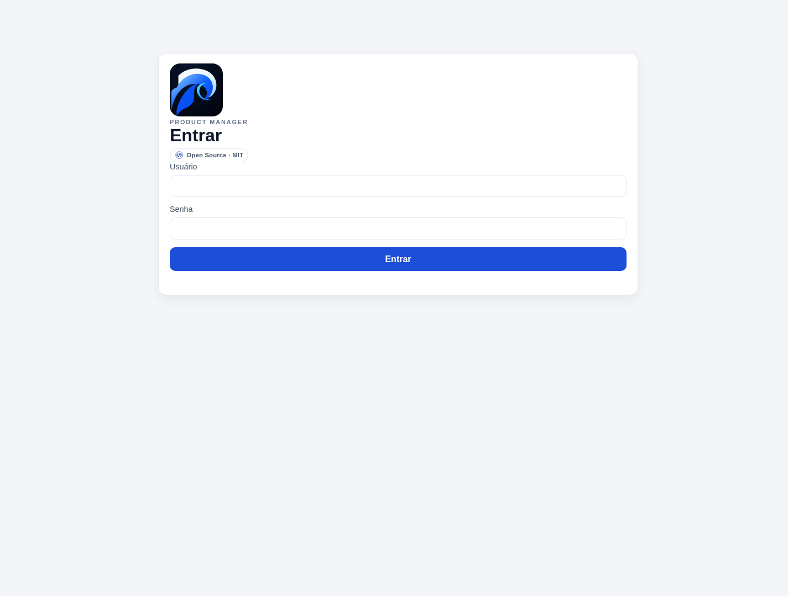
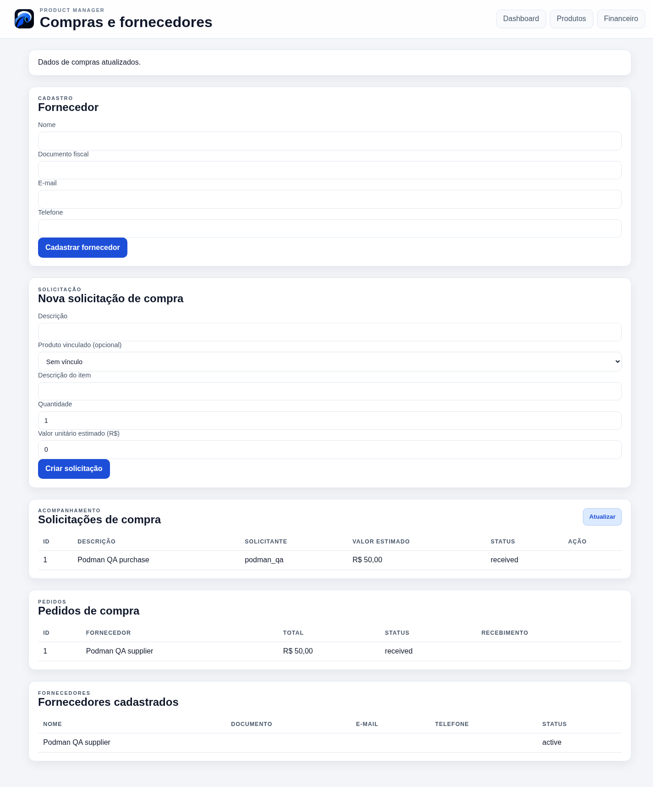
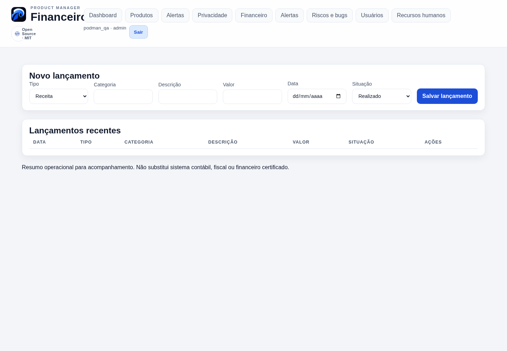
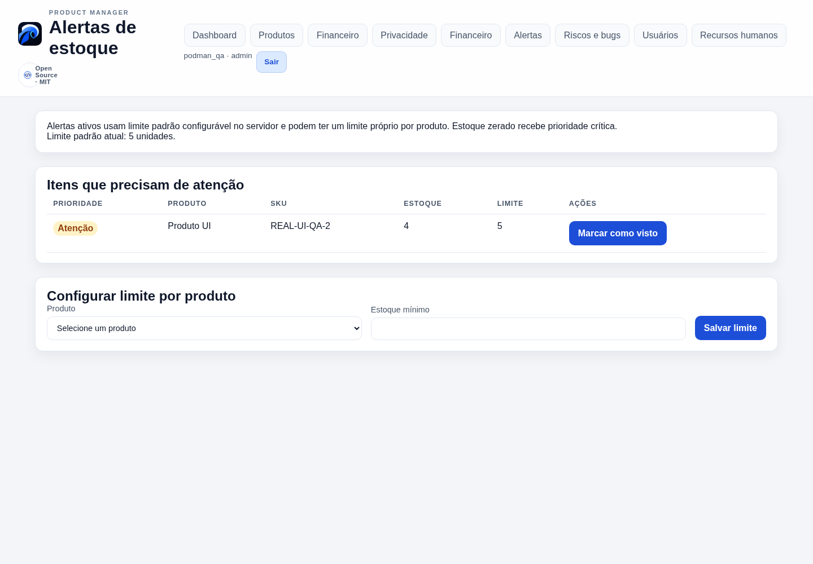
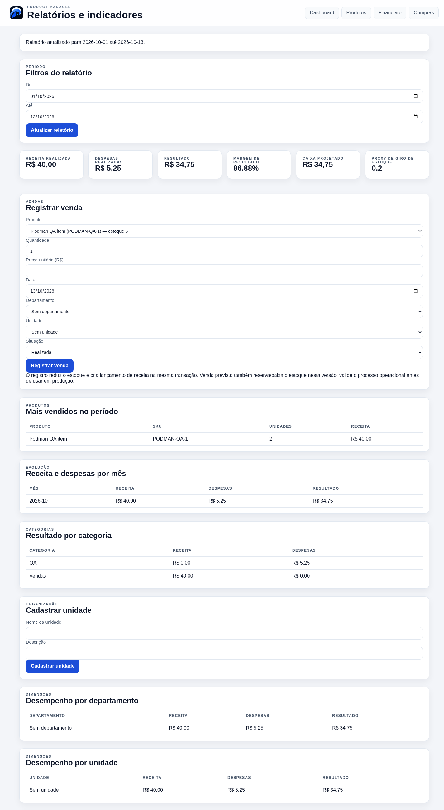
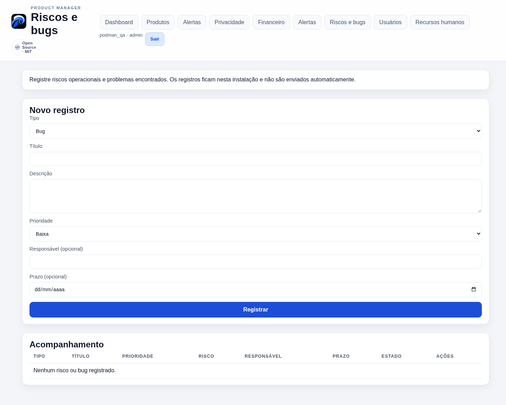
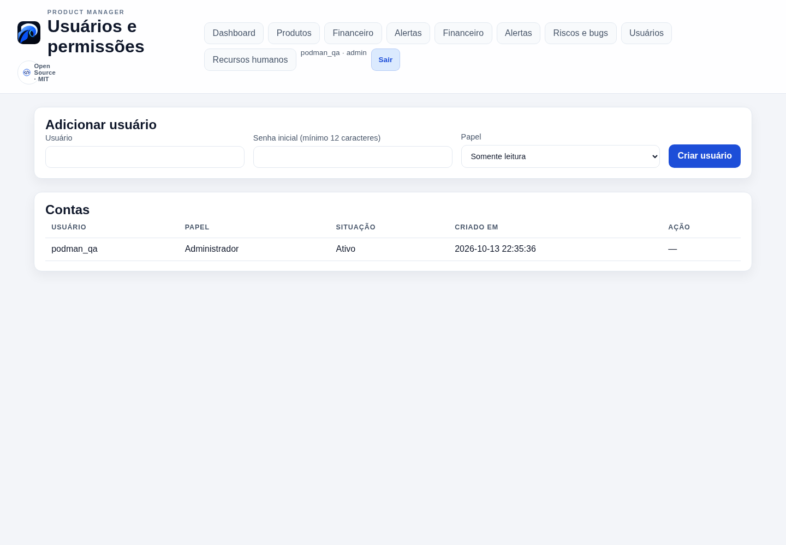
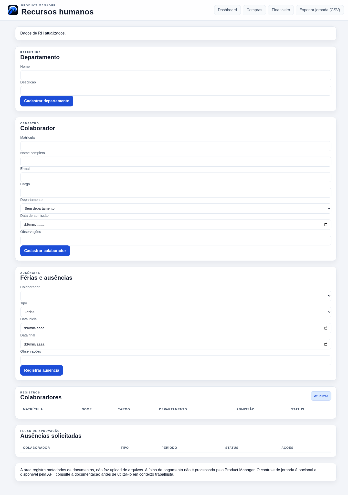

# Tutorial visual do Product Manager

Este guia acompanha o fluxo da interface web. As capturas foram feitas em 13/10/2026 no build local em Podman, com registros sintéticos de QA; elas não mostram dados de clientes ou da instância pública.

## 1. Primeiro acesso e login

Na primeira execução, um operador configura `PRODUCT_MANAGER_SETUP_TOKEN` no ambiente do servidor. Abra **Configuração inicial**, informe o token e crie o administrador com senha forte (mínimo de 12 caracteres). O token é de uso único e deixa de ser aceito depois do provisionamento. Nas próximas visitas, use o formulário **Entrar**. Não há usuário ou senha padrão.

## 2. Dashboard

O dashboard reúne contagem de clientes e produtos, estoque total, distribuição por categoria, produtos em atenção e clientes recentes. Use os botões para baixar CSV ou XLSX. Google Sheets só fica disponível quando o administrador configura a integração.

## 3. Produtos e estoque

Pesquise por nome, SKU, marca ou fornecedor; filtre por categoria e situação. Para cadastrar, preencha nome, categoria, SKU, referência, marca, situação, preço, quantidade e fornecedor. Ajuste o estoque pelas operações próprias da aplicação para manter o histórico de movimentos. Produtos com histórico não podem ser excluídos definitivamente; desativação preserva o registro.

## 4. Compras e recebimentos

Cadastre fornecedor e solicitação com itens e quantidades, registre cotações, aprove a solicitação e gere o pedido. Recebimentos podem ser parciais; informe as quantidades recebidas em cada etapa. A tela mostra o estado do pedido e as quantidades acumuladas. O estoque aumenta apenas pelo que foi recebido.

## 5. Financeiro

Registre receita ou despesa, categoria, descrição, valor, data e situação prevista ou paga. Os lançamentos são operacionais e não substituem contabilidade ou escrituração fiscal. O acesso de escrita depende do papel do usuário.

## 6. Alertas de estoque

Consulte produtos abaixo do limite e configure limites por produto. Reconhecer um alerta registra a ação para facilitar o acompanhamento.

## 7. Relatórios

Defina o período e consulte vendas e indicadores agregados. As vendas marcadas como pagas baixam o estoque e geram o lançamento financeiro correspondente dentro da mesma transação.

## 8. Riscos e bugs

Registre riscos ou bugs, prioridade, responsável e prazo. Atualize o estado ao longo do acompanhamento.

## 9. Usuários e papéis

Administradores criam e desativam contas e escolhem papéis. Viewer tem leitura; operator atua no catálogo e operações autorizadas; finance acessa rotinas financeiras; admin administra configuração e usuários. A API valida permissões, mesmo quando um controle não aparece na interface.

## 10. Recursos humanos

A área de RH é exclusiva de administradores e reúne departamentos, colaboradores, ausências, documentos e horas trabalhadas. Restrinja as informações pessoais às pessoas autorizadas.

## Encerrar sessão e exportar

Use **Sair** na navegação para invalidar a sessão atual. Exporte dados somente para destinos aprovados e proteja arquivos baixados: eles podem conter informações pessoais ou financeiras.

## Limites desta versão

Não há fluxo de cancelamento/estorno de venda ou compra na interface atual. Financeiro permite excluir alguns lançamentos, mas isso não equivale a um cancelamento rastreável de transação. Confirme os dados antes de registrar uma operação. As imagens demonstram as telas disponíveis; para recuperação do banco, consulte [implantação, backup e restauração](deployment.md).
