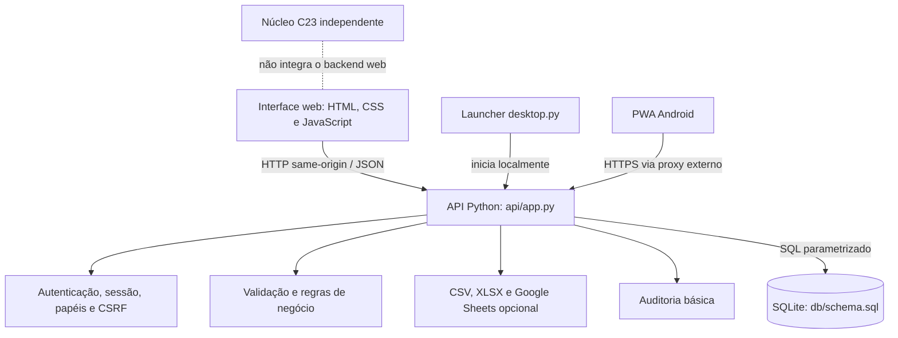
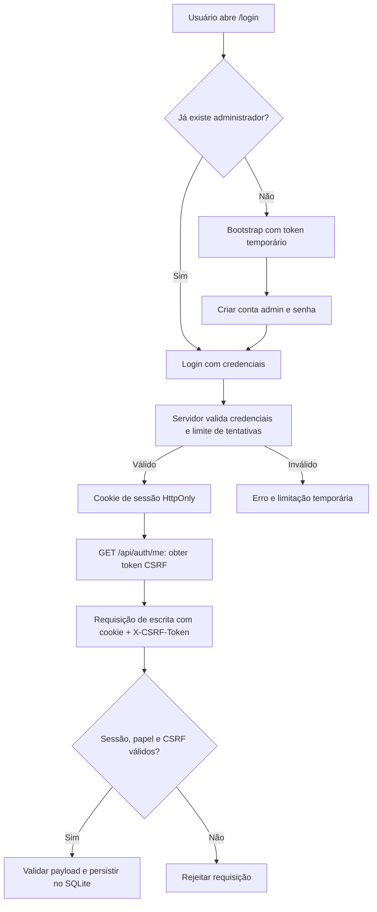

# Arquitetura

## Visão geral

O produto possui uma aplicação web Python/SQLite e um núcleo C23 separado. O desktop executa o servidor HTTP local e abre o navegador. No Android, a distribuição é um Progressive Web App (PWA), acessado por uma origem HTTPS administrada pela implantação.

## Componentes

| Caminho | Responsabilidade |
|---|---|
| `api/app.py` | Servidor HTTP, rotas JSON, autenticação, regras de acesso, validação, banco e exportações |
| `ui/` | Telas de login, dashboard, catálogo, usuários, compras, RH, financeiro, alertas, relatórios, riscos/bugs e arquivos PWA |
| `db/schema.sql` | Esquema inicial SQLite |
| `desktop.py` | Inicia servidor local, cria token temporário no primeiro uso e abre navegador |
| `config/` | Mapeamentos de campos usados pelo projeto |
| `assets/` | Ícones e diagramas SVG |
| `tests/` | Testes automatizados de API, PWA, commits e notas de release |
| `scripts/` | Utilitários, incluindo exportação do dashboard |
| `packaging/` | Scripts de empacotamento para Windows, Linux e implantação PWA |
| `Dockerfile`, `compose.yaml` | Build e execução em container |
| `src/`, `include/` | Núcleo C23 independente, legado/em evolução |
| `doc/`, `docs/` | Arquitetura, requisitos, modelo de dados, operação, instalação e resultados de teste |

## Inicialização e fluxo de requisição

1. O processo inicializa o esquema e configura o banco SQLite selecionado.
2. Antes da primeira conta, a aplicação permite o provisionamento de administrador por token temporário.
3. O usuário autentica-se e recebe cookie de sessão.
4. A interface consulta a API na mesma origem.
5. Rotas de negócio verificam sessão e papel; requisições de escrita também verificam o token CSRF.
6. A API valida os dados e persiste alterações no SQLite.
7. O dashboard e as exportações apresentam dados do workspace.

## Desktop

`desktop.py` cria um servidor HTTP vinculado por padrão a `127.0.0.1`, seleciona uma porta livre quando `PRODUCT_MANAGER_PORT=0`, e abre o navegador. Se ainda não há usuário, gera um token aleatório de bootstrap caso ele não esteja definido. O processo permanece ativo até ser encerrado.

## Persistência

O esquema é inicializado a partir de `db/schema.sql`; a API também contém lógica de compatibilidade para bancos existentes. O banco de desenvolvimento padrão é `db/product_manager.db`, mas `PRODUCT_MANAGER_DB` pode apontar para outro arquivo. O desktop empacotado usa o diretório de dados do usuário.

## Modelo de implantação

- **Desktop local:** usuário, servidor e banco no mesmo computador; adequado a avaliação local.
- **Container:** serviço em container e banco persistente no volume `product-manager-data`.
- **PWA:** frontend servido pela mesma origem que a API, atrás de proxy/servidor HTTPS.
- **Núcleo C23:** programa de terminal separado, compilado pelo Makefile; não é a camada de backend da aplicação web.

## Limites arquiteturais

A aplicação não implementa isolamento de dados por organização, identidade corporativa OIDC/SAML, TLS embutido, recuperação automatizada de senha, movimentações imutáveis de estoque ou contabilidade fiscal. Uma implantação compartilhada exige que a organização opere TLS, rede, backups, segredos e atualizações.

## Fluxo de autenticação e escrita

A figura descreve o fluxo geral documentado; as condições exatas de cada rota permanecem definidas em `api/app.py`.
