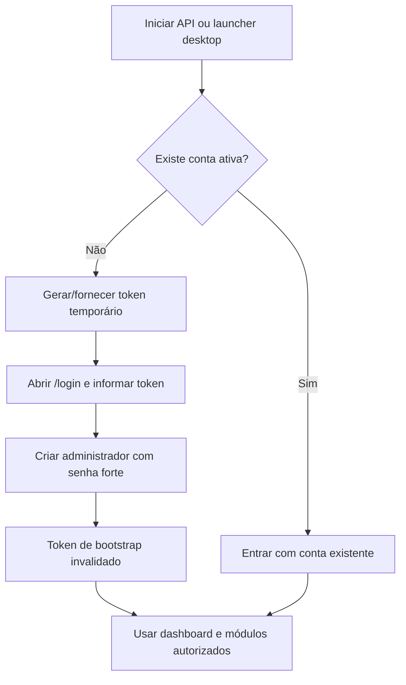

# Instalação e primeiro acesso

## Requisitos

- Python 3.10 ou superior para executar a API diretamente.
- Navegador moderno.
- Docker e Docker Compose para a opção em container.
- GCC ou Clang com suporte a C23 e GNU Make apenas para compilar o núcleo C.
- Para PWA: servidor publicado em HTTPS. O PWA não é um APK nativo.

## Executar a partir do código-fonte

```bash
git clone https://github.com/mnl-nox/product_manager.git
cd product_manager
python3 api/app.py
```

Abra http://127.0.0.1:8000. O banco padrão é `db/product_manager.db`. Para selecionar outro caminho:

```bash
PRODUCT_MANAGER_DB=/caminho/product_manager.db python3 api/app.py
```

O workspace começa vazio. Para avaliação local com registros demonstrativos, defina `PRODUCT_MANAGER_DEMO_DATA=1`; não use esses registros como dados reais.

## Primeiro administrador

Não existe usuário ou senha padrão. Para executar a API diretamente, gere um token temporário e inicie o servidor:

```bash
export PRODUCT_MANAGER_SETUP_TOKEN="$(python3 -c 'import secrets; print(secrets.token_urlsafe(32))')"
python3 api/app.py
```

Acesse `/login`, informe o token no formulário de configuração inicial e crie uma senha de pelo menos 12 caracteres. O token é removido do processo após o provisionamento; o bootstrap é bloqueado quando a conta inicial existe.

No launcher desktop, `python3 desktop.py` inicia o servidor local e abre o navegador. No primeiro uso, o launcher gera um token efêmero se necessário e abre o fluxo de configuração.

## Executar com Docker Compose

```bash
export PRODUCT_MANAGER_SETUP_TOKEN="$(python3 -c 'import secrets; print(secrets.token_urlsafe(32))')"
docker compose up --build -d
```

Abra `http://localhost:8000/login#setup_token=$PRODUCT_MANAGER_SETUP_TOKEN` e crie o administrador. O banco persiste no volume `product-manager-data`.

```bash
docker compose logs
docker compose down
```

`docker compose down` mantém o volume por padrão. Não remova o volume se precisar preservar os dados. O Compose publicado no repositório vincula a porta ao loopback e desativa cookies Secure para o teste local em HTTP; não reutilize essa configuração HTTP em produção.

## Instalação por plataforma

### Windows 10/11 x64

Baixe `ProductManager-<versão>-windows-x64-setup.exe` dos artefatos de release/workflow. O banco fica em `%LOCALAPPDATA%\ProductManager\product_manager.db`.

### Debian/Ubuntu

```bash
sudo apt install ./product-manager_<versão>_amd64.deb
```

O banco fica em `${XDG_DATA_HOME:-~/.local/share}/product-manager/product_manager.db`.

### Fedora/RHEL e derivados

```bash
sudo dnf install ./product-manager-<versão>-1.x86_64.rpm
```

### Android

A opção recomendada é o PWA: abra a URL HTTPS no Chrome para Android e escolha **Instalar app** ou **Adicionar à tela inicial**. O repositório também oferece um workflow opcional para gerar um wrapper APK de depuração que abre a mesma URL; ele depende do servidor HTTPS e não é um cliente independente nem um pacote release para Play Store.

## Fluxo de primeiro acesso



## Papéis de usuário

| Papel | Capacidades gerais |
|---|---|
| Administrador (`admin`) | Gerencia usuários, catálogo, financeiro, alertas e integração Google Sheets; pode remover produtos permanentemente |
| Operação (`operator`) | Consulta e altera clientes/produtos, limites e alertas |
| Financeiro (`finance`) | Consulta catálogo e gerencia lançamentos financeiros |
| Leitura (`viewer`) | Consulta dashboard, catálogo e alertas |

As permissões são verificadas no servidor, não apenas na interface. As contas compartilham o mesmo workspace.

## Rotina de uso

- **Dashboard:** consulta totais, categorias, clientes recentes e estoque crítico.
- **Produtos:** cadastra, edita, desativa e reativa itens; exclusão permanente é administrativa.
- **Alertas:** define mínimo por produto e reconhece alertas.
- **Financeiro:** registra receitas/despesas previstas ou realizadas e consulta saldo operacional.
- **Riscos e bugs:** registra itens internos; administração/operação pode atualizar estado e responsável.
- **Exportação:** baixa CSV/XLSX; Google Sheets depende de configuração do administrador.

## Backup e atualização

Encerre a aplicação antes de copiar o banco SQLite, proteja o arquivo e os backups como dados corporativos e teste periodicamente a restauração. Faça backup antes de atualizar a versão ou o esquema. Não há processo automatizado de recuperação de senha descrito nesta versão.

## Tutorial visual por seção

Veja [o tutorial visual completo](Tutorial-Visual.md), com login, dashboard, produtos, compras, financeiro, alertas, relatórios, riscos, usuários e RH. As capturas usam dados sintéticos locais.
